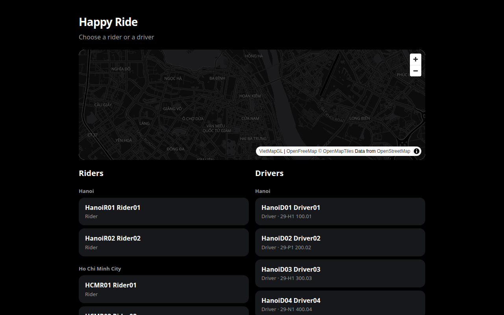
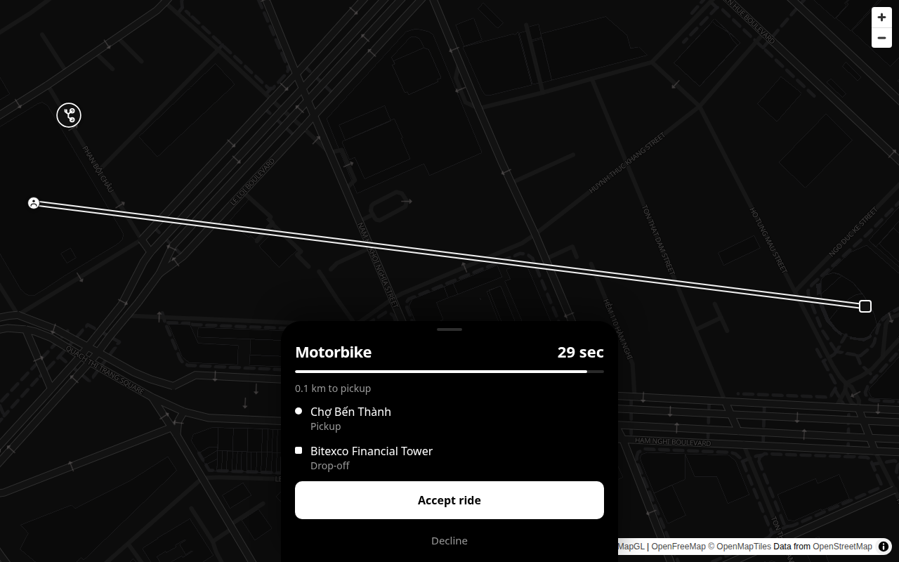
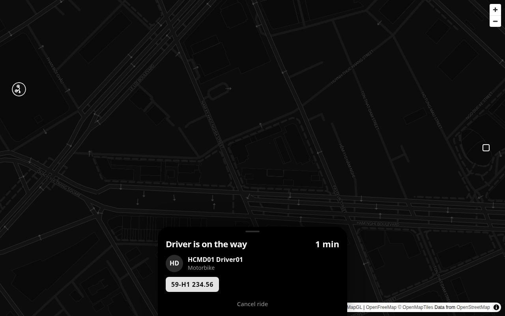

# happy-ride

[](https://github.com/hdduong/happy-ride/actions/workflows/build.yml)
[](https://github.com/hdduong/happy-ride/actions/workflows/ci.yml)
[](https://github.com/hdduong/happy-ride/actions/workflows/deploy.yml)
[](https://github.com/hdduong/happy-ride/releases/tag/v1.0.149)

Motorbike ride-hailing MVP for Hanoi and Ho Chi Minh City built with an ASP.NET Core 10 API (`src/HappyRide.Api`), PostgreSQL/PostGIS, SignalR, and a Next.js rider and driver web app (`web/`).

## Screenshots

### Home — Persona Picker & Light City Map



### Driver — Incoming Ride Offer on Light Street Map



### Rider — Matched Driver & Live Route on Light Street Map



## Local Setup

### Prerequisites

- [.NET 10 SDK](https://dotnet.microsoft.com/download/dotnet/10.0)
- [Node.js 22+](https://nodejs.org/)
- [Docker](https://www.docker.com/) (for local PostgreSQL 16 + PostGIS)

### 1. Start PostgreSQL with PostGIS

Start a local PostGIS container on port `5432`:

```bash
docker run -d \
  --name happyride-pg \
  -e POSTGRES_USER=happyride \
  -e POSTGRES_PASSWORD=happyride \
  -e POSTGRES_DB=happyride \
  -p 5432:5432 \
  postgis/postgis:16-3.4
```

If you have a `docker-compose.yml` configured for the workspace, `docker compose up -d` starts the same database. The default connection string in `src/HappyRide.Api/appsettings.json` is:

```text
Host=localhost;Port=5432;Database=happyride;Username=happyride;Password=happyride
```

On startup, the API enables the `postgis` extension, creates the schema, and seeds demo riders, drivers, and places.

### 2. Run the API

```bash
dotnet run --project src/HappyRide.Api --launch-profile http
```

The API listens at `http://localhost:5080`. Interactive OpenAPI docs are available at `http://localhost:5080/scalar/v1` and `http://localhost:5080/swagger` (`/` and `/scalar` redirect to Scalar).

### 3. Run the Web App

```bash
cd web
npm ci
npm run dev
```

Open `http://localhost:3000` to pick a rider or driver, or open two browser windows directly with seeded personas:

- Rider (`HCMR01 Rider01`): `http://localhost:3000/rider?as=11111111-1111-1111-1111-111111111111`
- Driver (`HCMD01 Driver01`): `http://localhost:3000/driver?as=33333333-3333-3333-3333-333333333333`

The browser talks to the Next.js server (`/backend/*`), which forwards requests to the API. Locally no Entra token is required.

### 4. Map Providers (Optional)

By default, `Maps:Provider` is `Fake`, which uses seeded places, simulated routes, and public OpenFreeMap tiles without requiring API keys. To use live providers locally, set user secrets or environment variables on the API:

- **VietMap:** `Maps__Provider=VietMap`, `Maps__VietMap__ApiKey`, `Maps__VietMap__TileKey`
- **Google Maps:** `Maps__Provider=Google`, `Maps__Google__ApiKey`, `Maps__Google__BrowserKey`

The browser only receives the public tile style or browser key from `GET /api/map-config`; server keys never leave the API.

### 5. Run Tests

```bash
# Backend integration and unit tests (uses Testcontainers PostGIS)
dotnet test happy-ride.sln --configuration Release

# Frontend state, session, and telemetry unit tests
cd web
npm test
npm run build

# End-to-end two-browser Playwright tests (requires Postgres on port 5432)
cd ../e2e
npm ci
npx playwright install chromium
npm test
```

## Deploy to Azure

A merge into `main` runs **Build** and **CI**. Build compiles the API and the web app. CI runs the API tests and the browser ride test. When both are green, CI opens a `deployment-request` issue. Azure changes only after you open [Deployment](https://github.com/hdduong/happy-ride/actions/workflows/deploy.yml), click **Run workflow**, check **Deploy to Azure production**, and click the green **Run workflow** button.

### Azure Architecture Provisioned

Running the deployment workflow provisions and updates the following resources in `rg-grabbike-dev` (`southeastasia` by default) via `.github/scripts/deploy-azure.sh` and `infra/main.bicep`:

- **App Service Plan (`plan-grabbike`):** Linux `B1` plan shared by the API and web apps.
- **API App Service (`app-grabbike-api`):** Self-contained `linux-x64` deployment of `HappyRide.Api` with WebSockets enabled.
- **Web App Service (`app-grabbike-web`):** Next.js standalone Node 22 server that proxies `/backend/*` to the API and attaches Microsoft Entra application tokens when configured.
- **Azure Database for PostgreSQL Flexible Server (`psql-grabbike-*`):** PostgreSQL 16 (`Standard_B1ms`) with the `POSTGIS` extension enabled and database `happyride`.
- **Azure Service Bus (`sb-grabbike-*`):** Basic tier namespace with the `dispatch` queue (`Dispatch__Bus=ServiceBus`).
- **Observability (`appi-grabbike-api` & `log-grabbike`):** Workspace-based Application Insights and Log Analytics workspace wired to both `happy-ride-api` and `happy-ride-web` via OpenTelemetry. Monitoring ingestion is usage-billed; see [`docs/observability.md`](docs/observability.md) for activation steps, KQL queries, and retention settings.

### GitHub Secrets and Variables

Configure these in **Settings → Environments → production** (or repository Actions settings):

| Name | Kind | Required | Description |
| --- | --- | --- | --- |
| `AZURE_CREDENTIALS` | Secret | Yes | Azure service principal JSON for `azure/login` with Contributor access to the resource group |
| `POSTGRES_ADMIN_PASSWORD` | Secret | Yes | Administrator password for Azure Database for PostgreSQL |
| `AZURE_CLIENT_SECRET` | Secret | Optional | Entra client secret for web-to-API bearer authentication (used when `AZURE_TENANT_ID` and `AZURE_API_CLIENT_ID` are set) |
| `VIETMAP_API_KEY` | Secret | Optional | VietMap server API key for autocomplete, geocoding, and routing |
| `VIETMAP_TILEMAP_KEY` | Secret | Optional | VietMap tile key for basemap rendering |
| `GOOGLE_MAPS_API_KEY` | Secret | Optional | Google Maps server API key (Places, Geocoding, Routes) |
| `GOOGLE_MAPS_BROWSER_KEY` | Secret | Optional | Google Maps browser JavaScript key |
| `APPLICATIONINSIGHTS_CONNECTION_STRING` | Secret | Optional | Overrides automatic Application Insights lookup/creation when set |
| `MAPS_PROVIDER` | Variable | Optional | `Google`, `VietMap`, or `Fake` (defaults to `VietMap` or `Google` when keys exist, otherwise `Fake`) |
| `AZURE_TENANT_ID` | Variable | Optional | Microsoft Entra tenant ID for API token protection |
| `AZURE_API_CLIENT_ID` | Variable | Optional | Entra application (client) ID of the API app registration |
| `AZURE_CLIENT_ID` | Variable | Optional | Entra client ID used by the web server (defaults to `AZURE_API_CLIENT_ID`) |
| `AZURE_API_SCOPE` | Variable | Optional | Entra scope requested by the web server (defaults to `api://<AZURE_API_CLIENT_ID>/.default`) |
| `AZURE_RESOURCE_GROUP` | Variable | Optional | Target resource group (default: `rg-grabbike-dev`) |
| `AZURE_LOCATION` | Variable | Optional | Azure region (default: `southeastasia`) |
| `AZURE_APP_SERVICE_PLAN` | Variable | Optional | App Service plan name (default: `plan-grabbike`) |
| `AZURE_API_APP_NAME` | Variable | Optional | API Web App name (default: `app-grabbike-api`) |
| `AZURE_WEB_APP_NAME` | Variable | Optional | Frontend Web App name (default: `app-grabbike-web`) |
| `API_BASE_URL` | Variable | Optional | Public API URL (default: `https://app-grabbike-api.azurewebsites.net`) |
| `WEB_BASE_URL` | Variable | Optional | Public web URL (default: `https://app-grabbike-web.azurewebsites.net`) |

### Run a Production Deployment

1. Merge your pull request into `main` and wait for **Build** and **CI** to complete with a green check.
2. In GitHub, open **Actions → Deployment → Run workflow**.
3. Check **Deploy to Azure production**, leave **Switch the live map without deploying** set to `none`, and click **Run workflow**.
4. The workflow verifies that **Build** and **CI** passed for the `main` commit, publishes the API and web artifacts, provisions/updates Azure infrastructure and Entra settings without downtime, tags the release as `v1.0.<commit count>`, updates the version badge in `README.md`, and closes any open `deployment-request` issue.

### Switch the Live Map Provider Without Redeploying

To flip the running Azure API between `Google` and `VietMap` without publishing a new build:

1. Open **Actions → Deployment → Run workflow**.
2. Leave **Deploy to Azure production** unchecked.
3. Choose `Google` or `VietMap` under **Switch the live map without deploying** and click **Run workflow**.
4. Update the `MAPS_PROVIDER` variable to match so the next full deployment keeps the same provider.

## Repository Docs

- [`AGENTS.md`](AGENTS.md) — how the team works in this repo
- [`.cursor/agents/`](.cursor/agents/) — planner, implementer, verifier, and reviewer
- [`docs/architecture.md`](docs/architecture.md) — feature ownership, dependency rules, and current implementation limits
- [`docs/observability.md`](docs/observability.md) — structured logs, trace IDs, Azure activation, queries, and volume/retention settings
- [`docs/build-plan.md`](docs/build-plan.md) — target MVP architecture and remaining integrations
- [`docs/slides/index.html`](docs/slides/index.html) — 4-slide "Why Happy Ride — Show & Tell" deck (published on [GitHub Pages](https://hdduong.github.io/happy-ride/))
